{"title":"나의 비둘기들 - 정상 겨드랑이를 찾아서 | AI Model Generation, Reading the DDPM Paper, and Darwin’s On the Origin of Species","date":"2024-12-10","draft":false,"format":"html","canvas":true,"css":"","splitView":true,"firstGroupEnabled":true,"secondGroup":{"enabled":true,"body":"<h2>(ENG) My Pigeons - AI Model Generation, Reading the DDPM Paper, and Darwin’s On the Origin of Species</h2><h3>Lately, I've been generating AI models and clothing for an eyewear lookbook. I started about three months ago and have since been experimenting with various image generation tools. After endlessly tweaking parameters and playing the generative lottery until I got the kind of face I wanted, I began to feel that I was no different from a monkey if I didn't understand how the technology actually worked. So, I consulted a friend who is a computer graphics researcher and read through the DDPM paper, underlining passages as I went. Because <strong style=\"caret-color: rgb(0, 0, 0); color: rgb(0, 0, 0); font-style: normal; font-variant-caps: normal; letter-spacing: normal; text-align: start; text-indent: 0px; text-transform: none; white-space: normal; word-spacing: 0px; -webkit-text-stroke-width: 0px; text-decoration: none;\">I know virtually nothing about mathematics.</strong></h3><h3>Diffusion Paper Source : <a target=\"_blank\" rel=\"noopener noreferrer\" href=\"https://hojonathanho.github.io/diffusion\">https://hojonathanho.github.io/diffusion</a></h3><h3><strong style=\"caret-color: rgb(0, 0, 0); color: rgb(0, 0, 0); font-style: normal; font-variant-caps: normal; letter-spacing: normal; text-align: start; text-indent: 0px; text-transform: none; white-space: normal; word-spacing: 0px; -webkit-text-stroke-width: 0px; text-decoration: none;\">To read the diffusion paper, I needed a basic understanding of Gaussian distributions, probability distributions, and the central limit theorem. In the process of learning these concepts, I finally understood the mathematical principle behind Gaussian blur, something I had frequently used in Photoshop and video editing.&nbsp;</strong></h3>
<figure data-writing-image=\"true\" style=\"width: 100%;\"><figcaption>Figure.1 Normal Distribution</figcaption></figure><figure data-writing-image=\"true\" style=\"width: 100%;\"><figcaption>Figure.2 Bean Machine.</figcaption></figure>
<h3>THE WORLD IS DEFINITELY A SIMULATION!! <strong style=\"caret-color: rgb(0, 0, 0); color: rgb(0, 0, 0); font-style: normal; font-variant-caps: normal; letter-spacing: normal; text-align: start; text-indent: 0px; text-transform: none; white-space: normal; word-spacing: 0px; -webkit-text-stroke-width: 0px; text-decoration: none;\">If I had learned mathematics through this kind of curiosity, I think I would have really enjoyed it.</strong></h3>
<figure data-writing-image=\"true\" style=\"width: 100%;\"><figcaption>Figure.3 Gaussian Blur in Photoshop</figcaption></figure><figure data-writing-image=\"true\" style=\"width: 48.5%;\"><figcaption>Figure.4 Traces of Notes I Can No Longer Decipher</figcaption></figure>
<h3>Of course, even after reading the paper, I had little choice but to keep playing the endless human-generation lottery in my day-to-day work.</h3><figure data-writing-image=\"true\" style=\"width: 75%;\"><figcaption>Figure.5 My Pigeon Loft (1)</figcaption></figure><h3><strong>[A Recipe for Generating Humans — How to Arrive at My Desired Face After Endless Rounds of the Human Lottery] written by me.</strong></h3><h3><strong>1. </strong>Using exclusively Asian facial features does not produce the face I am looking for. 2. A tiny proportion of facial features drawn from Caucasian, Black, or Hispanic reference images needs to be introduced. 3. Using exclusively female reference images tends to produce faces that are merely beautiful. A small proportion of masculine features from clean-cut male reference images needs to be incorporated. 4. Including reference images with makeup can cause the model to overemphasize makeup in the generated results. Using predominantly bare-faced references produces faces closer to those of luxury fashion house models.</h3><figure data-writing-image=\"true\" style=\"width: 75%;\"><figcaption>Figure.6 My Pigeon Loft (2)</figcaption></figure><figure data-writing-image=\"true\" style=\"width: 75%;\"><figcaption>Figure.7 My Pigeon Loft (3)</figcaption></figure><h3>As I blended faces to create new ones and combined Caucasian and Asian facial features to generate models of mixed-race appearance, I was reminded of Darwin's <em>On the Origin of Species</em>, which I am now revisiting.</h3><h3><strong>The way I select and regenerate images resembles the process of artificial selection described by Darwin.</strong> I select the images I like from those generated using my chosen inputs, recombine certain features to create new images, and then use those images as inputs for subsequent generations. While the variations in the generated images are somewhat random, which features are preserved and carried forward into the next generation depends on my own taste and judgment. This is the origin of species.... This is evolution, These are my pigeons!</h3>
<figure data-writing-image=\"true\" style=\"width: 100%;\"><figcaption>Figure.8 1868 Darwin's Pigeon breeds illustration 출처: <a href=\"https://www.sciencephoto.com/media/719895/view/1868-darwin-pigeon-breeds-illustration\" target=\"_blank\" rel=\"noopener noreferrer\">Sciencephoto</a></figcaption></figure><figure data-writing-image=\"true\" style=\"width: 50.5%;\"><figcaption>Figure.9 Charles Darwin, on The Origin of Species 출처: <a href=\"https://ko.wikipedia.org/wiki/%EC%A2%85%EC%9D%98_%EA%B8%B0%EC%9B%90\" target=\"_blank\" rel=\"noopener noreferrer\">Wikipedia</a></figcaption></figure>
<h3>There are some peculiar things I've encountered while generating AI models, particularly when I examine the feedback I receive.</h3><h3>By imposing a strict standard of ‘naturalness’ on the ‘artificial’ images produced by AI, we seem to be reinforcing a framework of what is considered ‘normal.’ It is already somewhat amusing and contradictory that we worry about artificiality in images generated by artificial intelligence, but what interests me more is this framework of normality.</h3><h3>Some examples of the feedback I've received include:</h3><h3>- The number of folds in the armpit - The model's breast size - The normal shape of the corners of the mouth - The shape of the outer ear</h3><h3>Yet humans themselves come in an astonishing variety of forms. Even a difference of a single millimeter can help us distinguish one person from another.</h3><h3>This process has made me question the assumption that a natural and convincing image must conform so closely to what we consider normal. After all, an image of a human that appears too perfect is often criticized for looking AI-generated.</h3><figure data-writing-image=\"true\" style=\"width: 75%;\"><figcaption>Figure.10 A Study of the Human Armpit</figcaption></figure><figure data-writing-image=\"true\" style=\"width: 80%;\"><figcaption>Figure.11 In Search of a Normal Armpit</figcaption></figure><figure data-writing-image=\"true\" style=\"width: 80%;\"><figcaption>Figure.12 In Search of a Normal Armpit</figcaption></figure><figure data-writing-image=\"true\" style=\"width: 80%;\"><figcaption>Figure.13 In Search of a Normal Armpit</figcaption></figure><h3><em>Does a human armpit normally have just one crease like that?</em> <em>Isn't it abnormal for a female model's chest to be that flat?</em></h3><h3>In contrast to the feedback we receive on AI-generated models, we have long removed wrinkles and corrected asymmetries when retouching photographs of real models. We have minimized pores and occasionally removed moles. Sometimes, while looking at a magnified image of a human ear during retouching, I would find its unfamiliar shape so peculiar that I would use Liquify to reshape it.</h3><figure data-writing-image=\"true\" style=\"width: 80%;\"><figcaption>Figure.14 Retouching Notes for a Photo Retoucher</figcaption></figure><h3>This is the typical level of retouching feedback for a lookbook photograph featuring a real human model. It's almost like the Ship of Theseus. Yet when retouching and upscaling AI-generated models, we composite additional skin texture to make them appear more natural. Visible pores sometimes become a criterion for judging how convincingly a generated image resembles a real photograph. We even add moles to faces to make them look more human. </h3><figure data-writing-image=\"true\" style=\"width: 40%;\"><figcaption>Figure.15 Is she normal?</figcaption></figure><h3>The fashion image industry has long been removing human imperfections. With the emergence of generative AI, however, we are now reproducing those very imperfections.</h3><h3>The pigeons I create are selected according to my own tastes, modified in response to other people's feedback, and then used as inputs for new images. Through this repeated process of selecting and generating images of humans, perhaps we are also constructing the very standards of what it means to look human.</h3><h3>Diffusion models approximate the probability distribution of their training data and generate new samples from it. Yet the images born from this process are held to a rigorous standard of ‘naturalness.’ The imperfections, distinctive features, and individual peculiarities that serve as markers of this naturalness have been bestowed upon humans over time, without deliberate design. I wonder whether this very quality, something uniquely human, might one day become a precious commodity.</h3>

","css":"","format":"html","canvas":true}}
---
<h2>(KOR) AI 모델 생성, DDPM 논문 읽기, 그리고 다윈의 『종의 기원』</h2><h3>요즘은 아이웨어 룩북을 위해 AI 모델과 의상을 생성하고 있다. 대략 3개월 전부터 시작해서 지금까지 여러 이미지 생성 툴을 활용 및 테스트 중에 있는데, 원하는 스타일의 얼굴이 나올 때까지 무한정 수정하고 생성 랜덤 갓챠를 돌리다보니 이 기술의 원리를 알지 않으면 원숭이랑 다를 바 없다는 기분이 들어 computer graphics researcher인 친구에게 물어서 DDPM 논문을 밑줄 그어가며 읽었다. 참고로 나는 수학은 정말 모른다.   Diffusion 논문 원문 : <a target="_blank" rel="noopener noreferrer" href="https://hojonathanho.github.io/diffusion">https://hojonathanho.github.io/diffusion</a></h3><h3>Diffusion 논문을 읽으려면 가우시안 분포부터, 확률 분포의 개념, 중심 극한정리에 대해선 가볍게 알고 있을 필요가 있어 배우게 되었는데, 포토샵이나 영상 편집 때 자주 쓰던 Gaussian blur의 원리를 알게 되었다.</h3>
<figure data-writing-image="true" style="width: 100%;">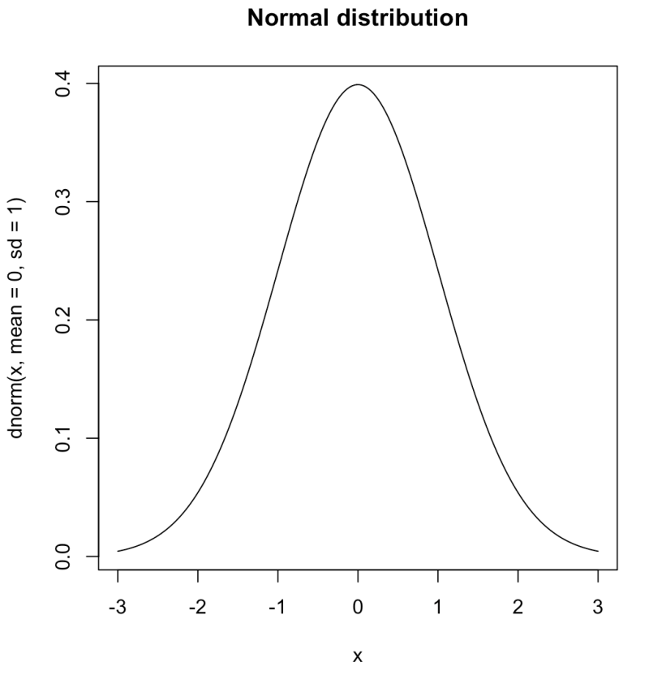<figcaption>Figure.1 Normal Distribution</figcaption></figure><figure data-writing-image="true" style="width: 100%;">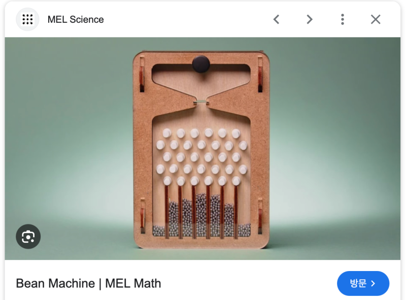<figcaption>Figure.2 Bean Machine.</figcaption></figure>
<h3>THE WORLD IS DEFINITELY A SIMULATION!! 수학을 이런 호기심에서 출발한 방식으로 배웠다면 정말 재밌게 배웠을 것이다.</h3>
<figure data-writing-image="true" style="width: 100%;">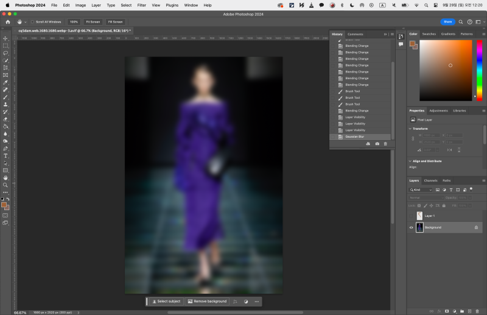<figcaption>Figure.3 Gaussian Blur in Photoshop</figcaption></figure><figure data-writing-image="true" style="width: 48.5%;">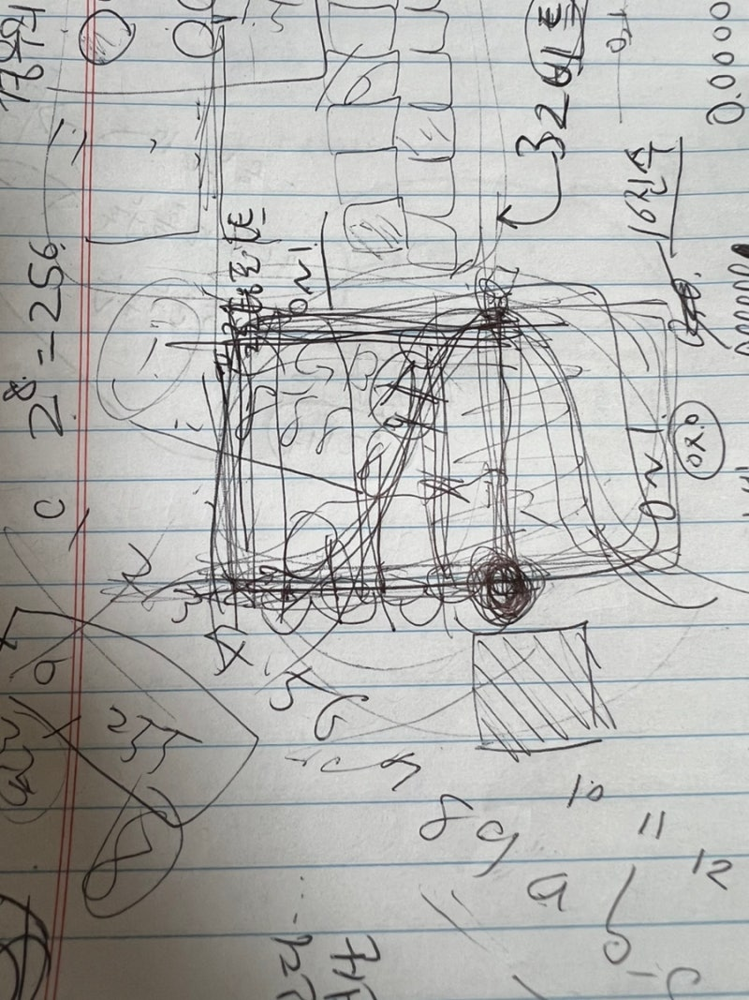<figcaption>Figure.4 Traces of Notes I Can No Longer Decipher</figcaption></figure>
<h3>물론 논문을 읽었지만, 실무에서는 무한 인간 생성 로또를 계속할 수 밖에 없었다.</h3><figure data-writing-image="true" style="width: 75%;">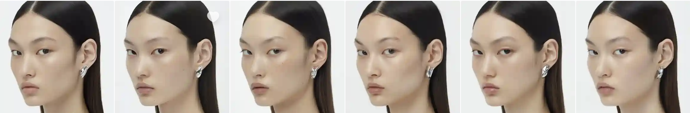<figcaption>Figure.5 My Pigeon Loft (1)</figcaption></figure><h3>[무한 인간 로또를 돌리며 파악한, 내가 원하는 얼굴에 도달하기 위한 인간 생성 레시피]  1. 아시안 단독 인자로는 내가 원하는 얼굴이 생성되지 않는다. 2. Caucasian, Black, Hispanic 등 Western의 얼굴 인자가 아주 작은 배율로 들어가야 한다. 3. 여성들로만 이루어진 이미지로는 '아름답기만 한' 이미지에 도달하기 십상이다. 깔끔한 이미지의 남성 인자가 아주 작은 배율로 포함되어야 한다. 4. 메이크업을 한 이미지가 포함되면 프롬프트가 과한 메이크업으로 자극될 수 있다. 최대한 bare face의 얼굴을 넣어야 럭셔리 하우스의 모델 같은 페이스가 나온다.</h3><figure data-writing-image="true" style="width: 75%;">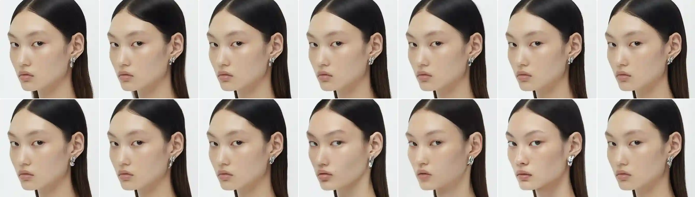<figcaption>Figure.6 My Pigeon Loft (2)</figcaption></figure><figure data-writing-image="true" style="width: 75%;">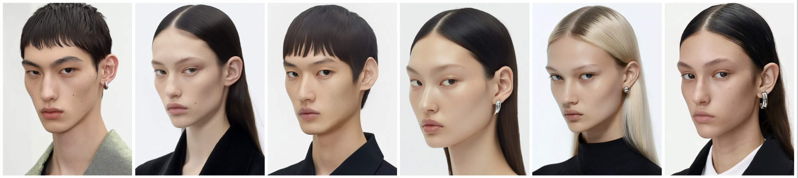<figcaption>Figure.7 My Pigeon Loft (3)</figcaption></figure><h3>원하는 얼굴끼리 blend해서 새로운 얼굴을 만들고 caucasian과 asian을 섞어 혼혈 느낌의 모델을 만드는 등의 행위를 하다 보니 이거 일종의 다윈&lt;종의 기원&gt;과 같은 생각이 들어 &lt;종의 기원&gt;또한 다시 일독하고 있다. 내가 이미지를 선택하고 다시 생성하는 방식은 다윈이 설명한 인위선택(artificial selection)과 닮아 있다. 내가 원하는 인자들을 넣어서 나온 이미지들 중 마음에 드는 것들을 선택하고, 그 특징들을 부분적으로 조합해서 또 새로운 이미지를 만들고, 그 이미지들을 인자로 써서 또 만들어내고 있다. 생성되는 이미지의 변이는 어느 정도 무작위적이지만, 그중 무엇을 남기고 다음 생성의 인자로 사용할지는 나의 취향과 판단에 달려 있다. 이게 종의 기원이자 진화다. 이들이 바로 나의 비둘기들인 것이다!</h3>
<figure data-writing-image="true" style="width: 100%;">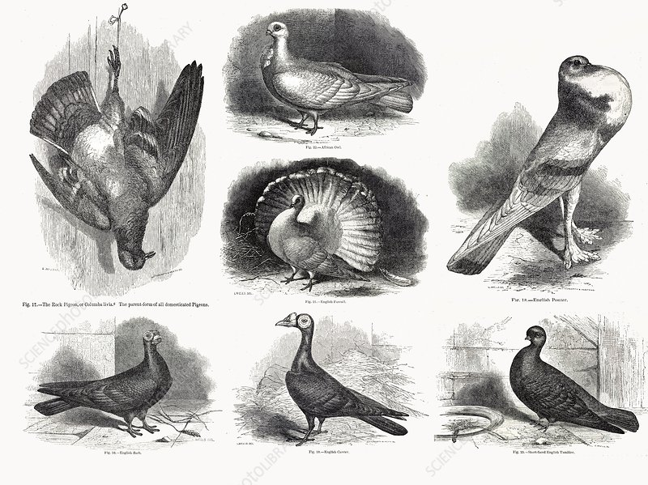<figcaption>Figure.8 1868 Darwin's Pigeon breeds illustration 출처: <a href="https://www.sciencephoto.com/media/719895/view/1868-darwin-pigeon-breeds-illustration" target="_blank" rel="noopener noreferrer">Sciencephoto</a></figcaption></figure><figure data-writing-image="true" style="width: 50.5%;">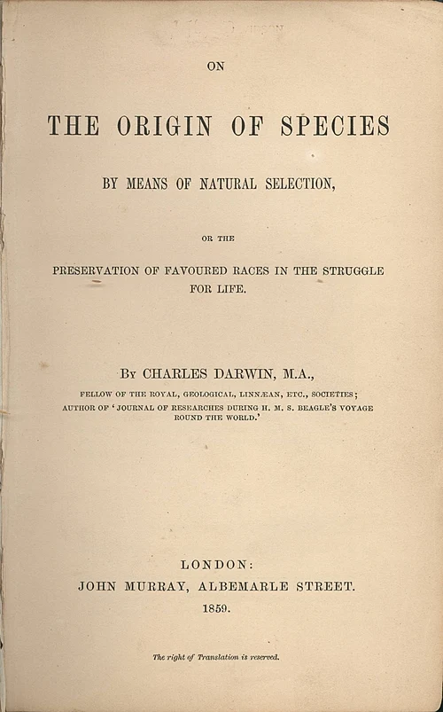<figcaption>Figure.9 Charles Darwin, on The Origin of Species 출처: <a href="https://ko.wikipedia.org/wiki/%EC%A2%85%EC%9D%98_%EA%B8%B0%EC%9B%90" target="_blank" rel="noopener noreferrer">Wikipedia</a></figcaption></figure>
<h3>AI 모델 생성을 하면서 겪는 묘한 지점들은 - 특히 받는 피드백들을 분석해보면, ‘자연스러움’이라는 잣대를 AI가 만들어내는 ‘인공적’인 이미지들에 엄격하게 들이대다보니 ‘정상적’인 무언가에 대한 프레임이 강화되고 있다는 것이다. 인공지능을 통해 만들어낸 평균적 이미지의 산물인 'generated' 이미지에 인공적인 느낌을 우려하는 것도 모순적이라 재미있지만, ‘정상’프레임에 대해 더 생각하게 된다.</h3><h3>내가 만든 이미지들에 왔던 피드백들을 예시로 들면,&nbsp;</h3><h3>- 겨드랑이의 주름 수 - 모델의 가슴 사이즈 - 정상적인 입꼬리 - 귓바퀴 모양</h3><h3>등이 있는데, 사실 인간이야말로 ‘참 다양하게도 생겼다’ 싶을 만큼 다 다르게 생겼고 1mm의 작은 차이가 사람을 식별하고 구분하는데 사용된다.&nbsp;</h3><h3>이 과정에서 ‘자연스럽고 그럴싸한’ 이미지는 정상성을 한가득 포함해야만 한다는 관점에 의문이 생겼다. 사실 너무 완벽한 인간의 이미지는 오히려 ai 생성 이미지라는 비판을 받기 때문이다.</h3><figure data-writing-image="true" style="width: 75%;">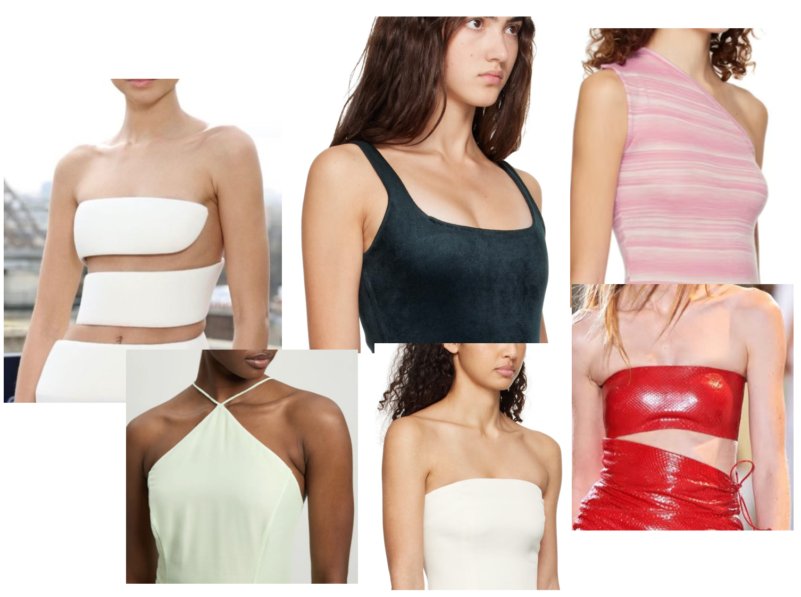<figcaption>Figure.10 인간의 겨드랑이는 어떻게 생겼나? A Study of the Human Armpit</figcaption></figure><figure data-writing-image="true" style="width: 80%;">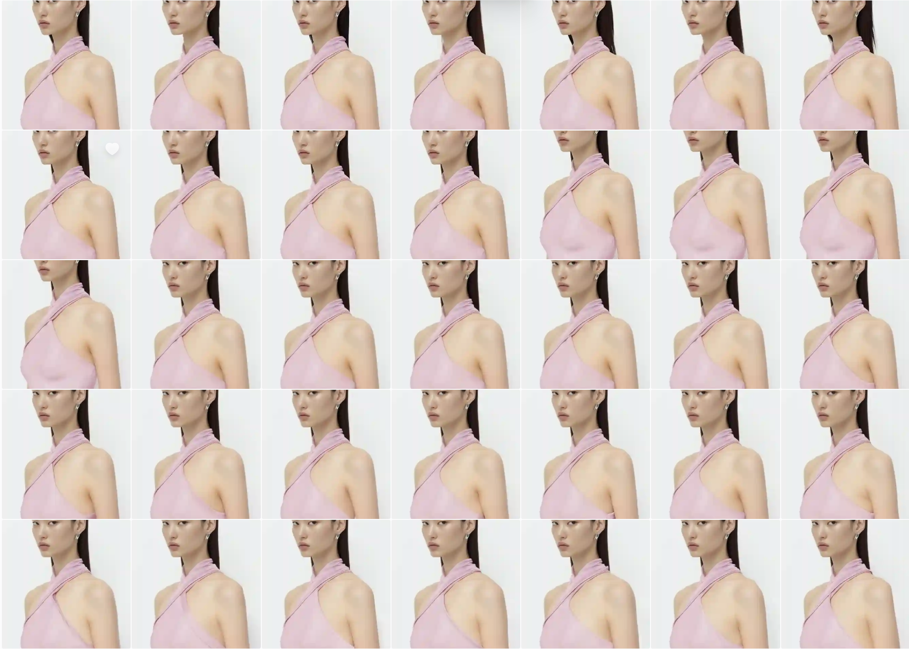<figcaption>Figure.11 정상적 겨드랑이를 향한 여정 In Search of a Normal Armpit</figcaption></figure><figure data-writing-image="true" style="width: 80%;">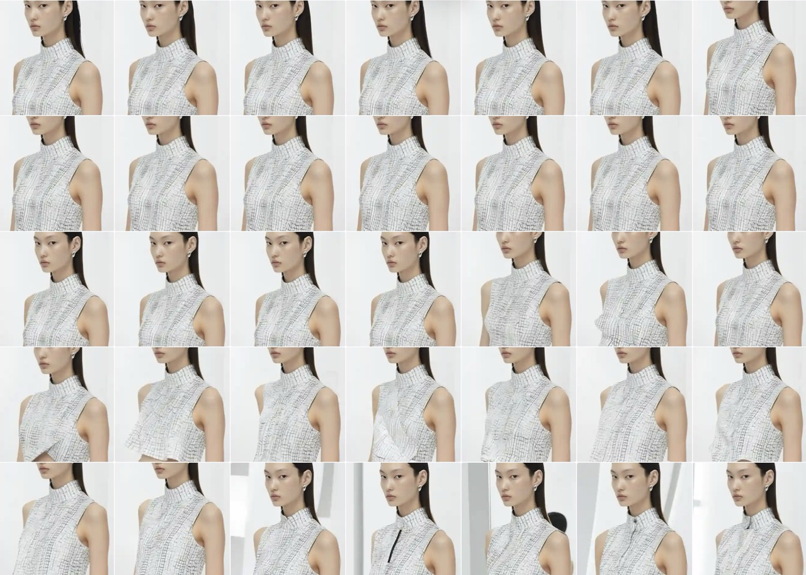<figcaption>Figure.12 정상적 겨드랑이를 향한 여정 In Search of a Normal Armpit</figcaption></figure><figure data-writing-image="true" style="width: 80%;">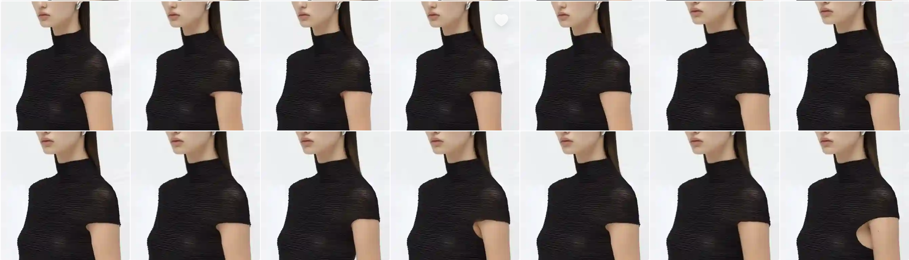<figcaption>Figure.13 정상적 겨드랑이를 향한 여정 In Search of a Normal Armpit</figcaption></figure><h3>AI 생성 모델에 대한 '보통 인간 겨드랑이에 주름이 저렇게 한개의 선으로 주름지나?', '여성 모델의 가슴이 저렇게 납작하면 비정상적이지 않은가?'라는 피드백과는 대비되게 우리는 실사 촬영시 모델의 주름을 제거했고, 비대칭을 교정해왔다. 옷의 실루엣을 위해 가슴 사이즈를 줄이기도 늘리기도 했고, 피부의 모공을 줄이고, 가끔은 점도 지우고, 때로 리터칭을 위해 확대된 인간의 귀를 보고 있자면 묘하게 특이한 이 귀의 모양에 적응되지 않아 liquify로 귀의 형태를 수정하기도 했다. &nbsp; </h3><figure data-writing-image="true" style="width: 80%;">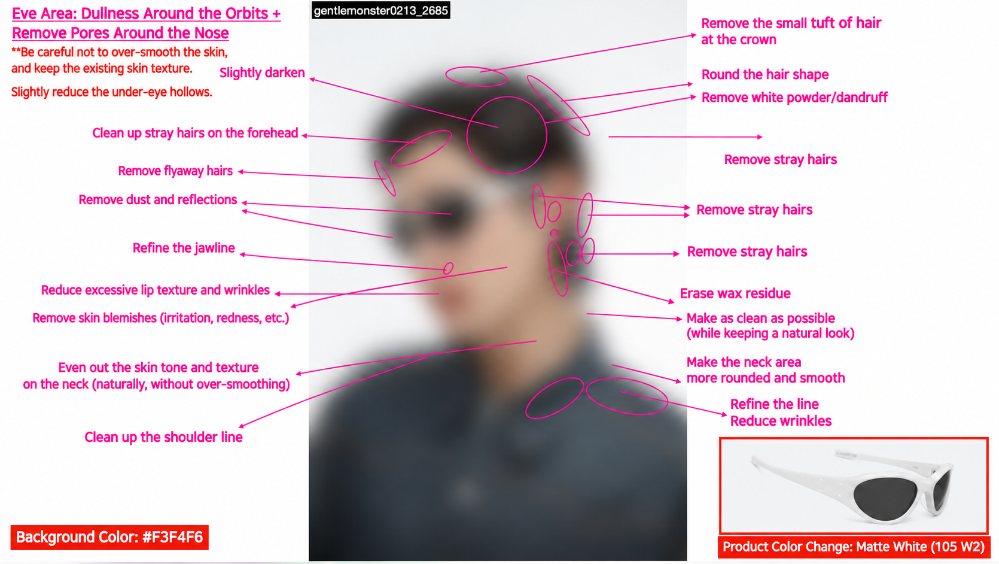<figcaption>Figure.14 사진 리터쳐를 위한 작업 요청서</figcaption></figure><h3>보통 룩북 이미지 실사 촬영본을 보정하게 되면, 이 정도의 피드백이 들어간다. 테세우스의 배나 다름없다.</h3><figure data-writing-image="true" style="width: 40%;"><figcaption>Figure.15 이 인물은 정상일까?</figcaption></figure><h3>하지만 AI 생성 모델을 리터칭하고 upscale하는 과정에서, 우리는 자연스러움을 추가하기 위해 피부결을 더 잘 보이게 합성하고, 모공을 때로는 ‘자연스럽게 나온 진짜 사진에 가까운 생성이미지’의 평가 잣대로 두기도 하며 ‘인간답게 보이기 위해’ 얼굴에 점과 주근깨를 추가하기도 했다.&nbsp;  패션 이미지 산업은 오랫동안 인간의 불완전성을 제거해 왔는데, 생성형 AI의 등장으로 바로 그 불완전성을 다시 생산하고 있다.&nbsp;</h3><h3>내가 만들어낸 비둘기들은 나의 취향에 따라 선택되고, 또 다른 사람들의 피드백에 따라 수정되며, 새로운 이미지의 인자가 된다. 그렇게 반복적으로 인간의 이미지를 선택하고 만들어내는 과정에서, 우리는 어쩌면 인간다움의 기준 또한 만들어내고 있는지도 모르겠다.</h3><h3>Diffusion이라는 학습 데이터의 확률분포를 근사하고 그로부터 새로운 샘플을 생성하는 모델에 의해 태어난 결과물에 엄격하게 제약되는 ‘자연스러움’. 그리고 자연스러움의 잣대가 되는 인간의 결점과 특징, 개성들은 어떠한 의도 없이 시간의 흐름 속에 인간에게 주어져왔고, 이것이 인간만이 가진 특수성 귀한 재화가 될 수도 있겠다는 생각을 한다.&nbsp;</h3>

