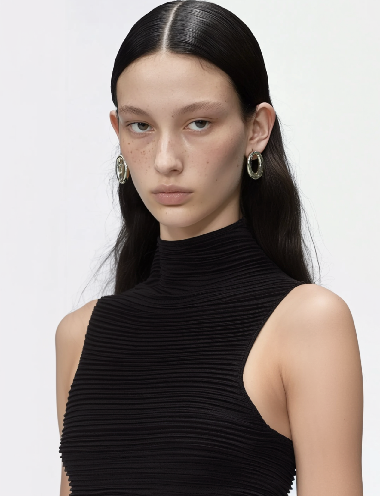

{"title":"나의 비둘기들 - 정상 겨드랑이를 찾아서 | AI Model Generation, Reading the DDPM Paper, and Darwin’s On the Origin of Species","date":"2024-12-10","draft":false,"format":"html","canvas":true,"css":""}
---
<h2>나의 비둘기들 - 정상 겨드랑이를 찾아서 : AI 모델 생성, DDPM 논문 읽기, 그리고 다윈의 『종의 기원』</h2><h3>요즘은 아이웨어 룩북을 위해 AI 모델과 의상을 생성하고 있다. 대략 3개월 전부터 시작해서 지금까지 여러 이미지 생성 툴을 활용 및 테스트 중에 있는데, 원하는 스타일의 얼굴이 나올 때까지 무한정 수정하고 생성 랜덤 갓챠를 돌리다보니 이 기술의 원리를 알지 않으면 원숭이랑 다를 바 없다는 기분이 들어 computer graphics researcher인 친구에게 물어서 DDPM 논문을 밑줄 그어가며 읽었다. 또한, 원하는 얼굴끼리 blend해서 새로운 얼굴을 만들고 caucasian과 asian을 섞어 혼혈 느낌의 모델을 만드는 등의 행위를 하다 보니 이거 일종의 다윈&lt;종의 기원&gt;과 같은 생각이 들어 &lt;종의 기원&gt;또한 다시 일독하고 있다. 내가 원하는 인자들을 넣어서 나온 이미지들 중 맘에 드는 것들을 부분적으로 조합해서 또 새로운 이미지를 만들고, 그 이미지들을 인자로 써서 또 만들어내고. 이게 종의 기원이자 진화다.... 이게 나의 비둘기인 것이다.</h3><figure data-writing-image="true" style="width: 75%;"><figcaption>My pigeon nest</figcaption></figure><h3>AI 모델 생성을 하면서 겪는 묘한 지점들은 - 특히 받는 피드백들을 분석해보면, ‘자연스러움’이라는 잣대를 AI가 만들어내는 ‘인공적’인 이미지들에 엄격하게 들이대다보니 ‘정상적’인 무언가에 대한 프레임이 강화되고 있다는 것이다. 인공 지능을 통해 만들어낸 평균적 이미지의 산물인 generated 이미지에 인공적인 느낌을 우려하는 것도 모순적이라 재미있지만, ‘정상’프레임에 대해 더 생각하게 된다.</h3><h3>내가 만든 이미지들에 왔던 피드백들을 예시로 들면,&nbsp;</h3><h3>- 겨드랑이의 주름 수 - 모델의 가슴 사이즈 - 정상적인 입꼬리 - 귓바퀴 모양</h3><h3>등이 있는데, 사실 인간이야말로 ‘참 다양하게도 생겼다’ 싶을 만큼 다 다르게 생겼고 1mm의 작은 차이가 사람을 식별하고 구분하는데 사용된다.&nbsp;</h3><h3>이 과정에서 ‘자연스럽고 그럴싸한’ 이미지는 정상성을 한가득 포함해야만 한다는 관점에 의문이 생겼다. 사실 너무 완벽한 인간의 이미지는 오히려 ai 생성이미지라는 비판을 받기 때문이다.</h3><figure data-writing-image="true" style="width: 50%;"><figcaption>정상적 겨드랑이를 향한 여정 In Search of a Normal Armpit</figcaption></figure><figure data-writing-image="true" style="width: 50%;"><figcaption>정상적 겨드랑이를 향한 여정 In Search of a Normal Armpit</figcaption></figure><figure data-writing-image="true" style="width: 50%;"><figcaption>정상적 겨드랑이를 향한 여정 In Search of a Normal Armpit</figcaption></figure>

<h3>AI 생성 모델에 대한 '보통 인간 겨드랑이에 주름이 저렇게 한개의 선으로 주름지나?', '여성 모델의 가슴이 저렇게 납작하면 비정상적이지 않은가?'라는 피드백과는 대비되게 우리는 실사 촬영시 모델의 주름을 제거했고, 비대칭을 교정해왔다. 옷의 실루엣을 위해 가슴 사이즈를 줄이기도 늘리기도 했고, 피부의 모공을 줄이고, 가끔은 점도 지우고, 때로 리터칭을 위해 확대된 인간의 귀를 보고 있자면 묘하게 특이한 이 귀의 모양에 적응되지 않아 liquify로 귀의 형태를 수정하기도 했다. &nbsp;하지만 AI 생성 모델을 리터칭하고 upscale하는 과정에서, 우리는 자연스러움을 추가하기 위해 피부결을 더 잘 보이게 합성하고, 모공을 때로는 ‘자연스럽게 나온 진짜 사진에 가까운 생성이미지’의 평가 잣대로 두기도 하며 ‘인간답게 보이기 위해’ 얼굴에 점과 주근깨를 추가하기도 했다.&nbsp;</h3><figure data-writing-image="true" style="width: 50%;"></figure><h3>패션 이미지 산업은 오랫동안 인간의 불완전성을 제거해 왔는데, 생성형 AI의 등장으로 바로 그 불완전성을 다시 생산하고 있다.&nbsp;</h3><h3>내가 만들어낸 비둘기들은 나의 취향에 따라 선택되고, 또 다른 사람들의 피드백에 따라 수정되며, 새로운 이미지의 인자가 된다. 그렇게 반복적으로 인간의 이미지를 선택하고 만들어내는 과정에서, 우리는 어쩌면 인간다움의 기준 또한 만들어내고 있는지도 모르겠다.</h3><h3>Diffusion이라는 학습 데이터의 확률분포를 근사하고 그로부터 새로운 샘플을 생성하는 모델에 의해 태어난 결과물에 엄격하게 제약되는 ‘자연스러움’. 그리고 자연스러움의 잣대가 되는 인간의 결점과 특징, 개성들은 어떠한 의도 없이 시간의 흐름 속에 인간에게 주어져왔고, 이것이 인간만이 가진 특수성 귀한 재화가 될 수도 있겠다는 생각을 한다.&nbsp;</h3>

-
<h2>(ENG) My Pigeons - AI Model Generation, Reading the DDPM Paper, and Darwin’s On the Origin of Species</h2><h3>Lately, I've been generating AI models and clothing for an eyewear lookbook. I started about three months ago and have since been experimenting with various image generation tools. After endlessly tweaking parameters and playing the generative lottery until I got the kind of face I wanted, I began to feel that I was no different from a monkey if I didn't understand how the technology actually worked. So, I consulted a friend who is a computer graphics researcher and read through the DDPM paper, underlining passages as I went.</h3>

<figure data-writing-image="true" style="width: 75%;"><figcaption>My pigeon nest</figcaption></figure><h3>As I blended faces to create new ones and combined Caucasian and Asian facial features to generate models of mixed-race appearance, I was reminded of Darwin's <em>On the Origin of Species</em>, which I am now revisiting.</h3><h3>I select the images I like from those generated using my chosen inputs, combine certain features to produce new images, and then use those images as inputs for the next generation.</h3><h3>This is the origin of species. This is evolution...</h3><h3>These are my pigeons.</h3><h3>There are some peculiar things I've encountered while generating AI models, particularly when I examine the feedback I receive.</h3><h3>By imposing a strict standard of ‘naturalness’ on the ‘artificial’ images produced by AI, we seem to be reinforcing a framework of what is considered ‘normal.’ It is already somewhat amusing and contradictory that we worry about artificiality in images generated by artificial intelligence, but what interests me more is this framework of normality.</h3><h3>Some examples of the feedback I've received include:</h3><h3>- The number of folds in the armpit - The model's breast size - The normal shape of the corners of the mouth - The shape of the outer ear</h3><h3>Yet humans themselves come in an astonishing variety of forms. Even a difference of a single millimeter can help us distinguish one person from another.</h3><h3>This process has made me question the assumption that a natural and convincing image must conform so closely to what we consider normal. After all, an image of a human that appears too perfect is often criticized for looking AI-generated.</h3><figure data-writing-image="true" style="width: 50%;"><figcaption>정상적 겨드랑이를 향한 여정 In Search of a Normal Armpit</figcaption></figure><figure data-writing-image="true" style="width: 50%;"><figcaption>정상적 겨드랑이를 향한 여정 In Search of a Normal Armpit</figcaption></figure><figure data-writing-image="true" style="width: 50%;"><figcaption>정상적 겨드랑이를 향한 여정 In Search of a Normal Armpit</figcaption></figure><h3><em>Does a human armpit normally have just one crease like that?</em></h3><h3><em>Isn't it abnormal for a female model's chest to be that flat?</em></h3><h3>In contrast to the feedback we receive on AI-generated models, we have long removed wrinkles and corrected asymmetries when retouching photographs of real models. We have minimized pores and occasionally removed moles. Sometimes, while looking at a magnified image of a human ear during retouching, I would find its unfamiliar shape so peculiar that I would use Liquify to reshape it.</h3><h3>Yet when retouching and upscaling AI-generated models, we composite additional skin texture to make them appear more natural. Visible pores sometimes become a criterion for judging how convincingly a generated image resembles a real photograph. We even add moles to faces to make them look more human.</h3><figure data-writing-image="true" style="width: 50%;"></figure><h3>The fashion image industry has long been removing human imperfections. With the emergence of generative AI, however, we are now reproducing those very imperfections.</h3><h3>The pigeons I create are selected according to my own tastes, modified in response to other people's feedback, and then used as inputs for new images. Through this repeated process of selecting and generating images of humans, perhaps we are also constructing the very standards of what it means to look human.</h3><h3>Diffusion models approximate the probability distribution of their training data and generate new samples from it. Yet the images born from this process are held to a rigorous standard of ‘naturalness.’</h3><h3>The imperfections, distinctive features, and individual peculiarities that serve as markers of this naturalness have been bestowed upon humans over time, without deliberate design.</h3><h3>I wonder whether this very quality, something uniquely human, might one day become a precious commodity.</h3><h3></h3>

