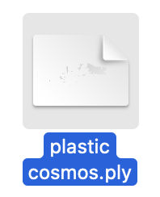
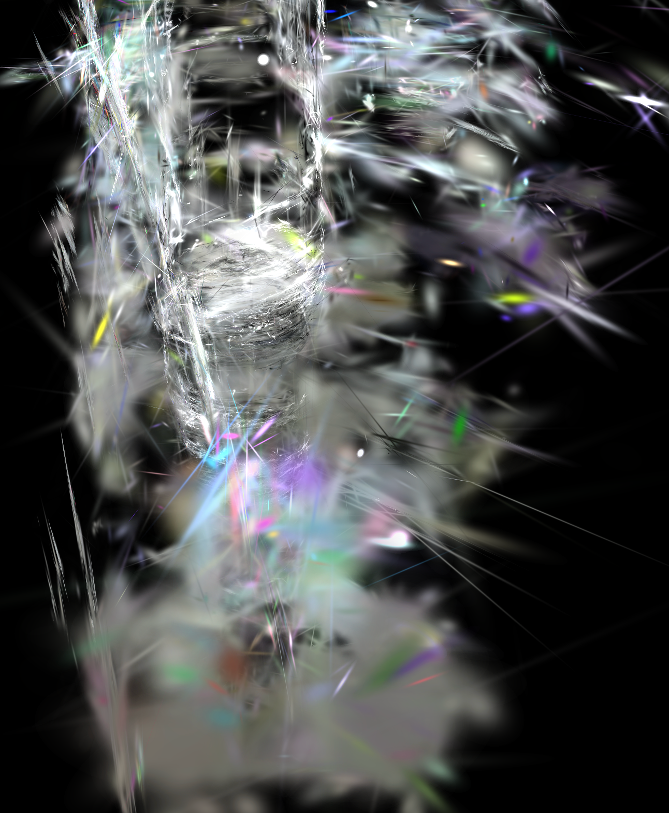
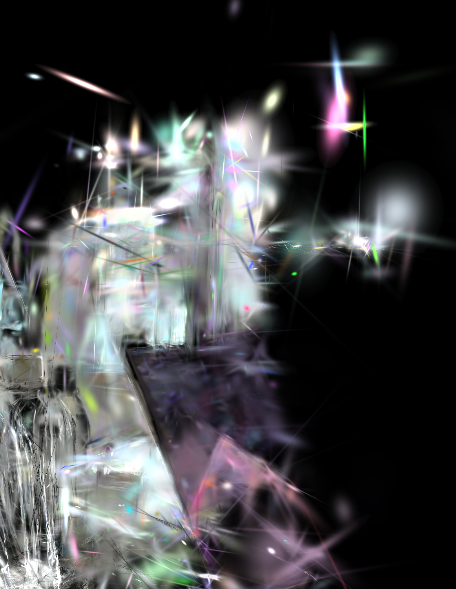
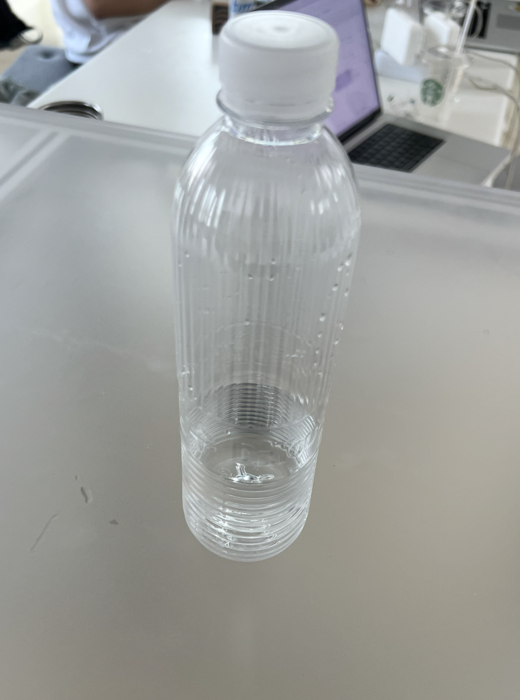
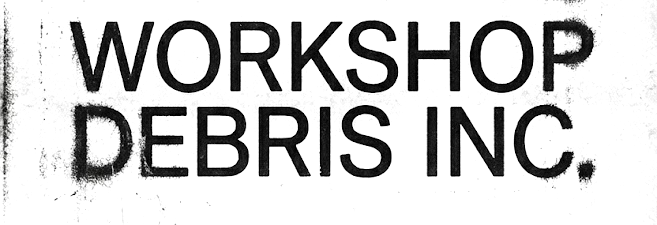

{"title":"Gaussian splatting Workshop","date":"2025-06-08","draft":false,"format":"html","canvas":true,"css":"","splitView":true,"firstGroupEnabled":true,"secondGroup":{"enabled":true,"body":"<h3>(ENG) Gaussian splatting Workshop</h3><h3>I explored Gaussian splatting as a way to produce visual results similar to 3D scanning. I chose a transparent plastic bottle, which proved difficult to visually separate from its surroundings, resulting in an unexpected image. Although technically a failed reconstruction, I was quite satisfied with the result, as it resembled a glimpse of the universe within a piece of plastic waste.</h3><figure data-writing-image=\"true\" style=\"width: 20%;\"></figure>

<figure data-writing-image=\"true\" style=\"width: 70%;\"><figcaption>Plastic Cosmos (1)</figcaption></figure><figure data-writing-image=\"true\" style=\"width: 70%;\"><figcaption>Plastic Cosmos (2)</figcaption></figure><figure data-writing-image=\"true\" style=\"width: 70%;\"><figcaption>This is the PET bottle I captured on video.</figcaption></figure>

<iframe src=\"https://superspl.at/s?id=06bb24c6\" title=\"Plastic Cosmos — Interactive 3D\" width=\"560\" height=\"315\" allowfullscreen=\"\" loading=\"lazy\"></iframe><h3>Since the result was not what I had originally anticipated, I had to rotate it and explore different viewpoints to find visually appealing angles.</h3>

<figure data-writing-image=\"true\" style=\"width: 10%;\"></figure>

","css":"","format":"html","canvas":true}}
---
<h3>(KOR) Gaussian splatting Workshop</h3><h3>가우시안 스플래팅으로 3d scan과 비슷한 시각적 결과물을 내는 것을 탐구했다. 투명한 페트병을 골랐더니 시각적 분리가 잘 되지 않아서 특이한 결과물이 나왔다. 엄격하게는 오류가 나서 잘못된 것이지만 나름 플라스틱 쓰레기 속에서 우주를 보는 듯한 모습이 들어 만족스럽기도 했다.</h3><figure data-writing-image="true" style="width: 20%;"></figure>

<figure data-writing-image="true" style="width: 70%;"><figcaption>Plastic Cosmos (1)</figcaption></figure><figure data-writing-image="true" style="width: 70%;"><figcaption>Plastic Cosmos (2)</figcaption></figure><figure data-writing-image="true" style="width: 70%;"><figcaption>이것이 내가 촬영한 물병이다.</figcaption></figure>

<iframe src="https://superspl.at/s?id=06bb24c6" title="Plastic Cosmos — Interactive 3D" width="560" height="315" allowfullscreen="" loading="lazy"></iframe><h3>본래의 예상과 벗어난 탓에 이리저리 돌려보며 예쁜 각을 찾아야만 했다.</h3>

<figure data-writing-image="true" style="width: 10%;"></figure>

