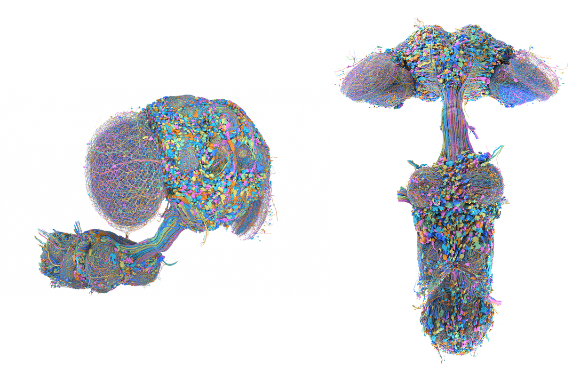
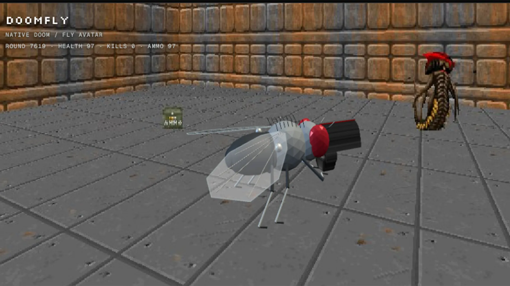
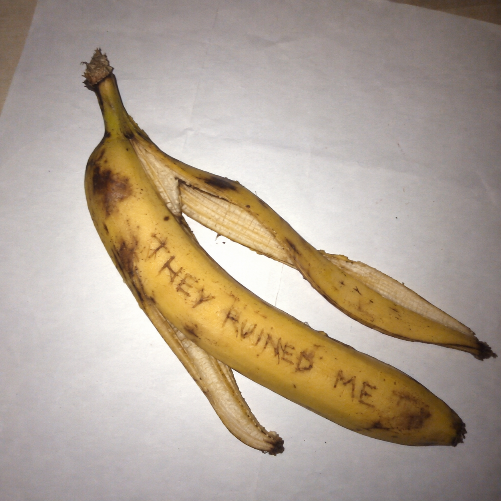

{"title":"“Can a fruit fly write a love letter?”","date":"2026-09-06","draft":false,"format":"html","canvas":true,"css":""}
---
<h3><strong>&lt;When I say that something has learned, experienced, or expressed something, what evidence would actually allow me to say that?&gt;</strong></h3><h3><strong>초파리 커넥툼으로부터 출발해, 어떤 존재가 경험하고, 학습하고, 표현했다고 말할 수 있는 조건은 무엇이며, 그 과정에서 창작자는 어디까지 개입할 수 있는가?까지 온 탐구과정을 기록해보게 되었다.</strong></h3><h3><strong>2026. 09.03</strong> <a target="_blank" rel="noopener noreferrer" href="https://research.google/blog/a-connectomics-milestone-mapping-the-complete-male-fruit-fly-brain/">https://research.google/blog/a-connectomics-milestone-mapping-the-complete-male-fruit-fly-brain/</a> 구글에서 초파리의 뇌 신경망 지도를 공개했다. 처음 소식을 접했을 땐 커넥툼의 개념을 명확히 파악하지 못한 상태라, 초파리의 뇌가 디지털에서 복원된 것이라고 생각했다. 커넥툼은 지하철 시스템으로 비유하면 지하철 노선도 같은 개념이고, 노선도가 있다고 해서 우리가 교통 시스템을 이해할 수는 없는 것 처럼, 신경망의 모습을 복원한 것에 가까웠다.</h3><figure data-writing-image="true" style="width: 50%;"><figcaption>Figure1. Male Fly Connectum. 출처: <a href="https://research.google/blog/a-connectomics-milestone-mapping-the-complete-male-fruit-fly-brain/" target="_blank" rel="noopener noreferrer">Google Research</a></figcaption></figure><h3><strong>2026. 09. 06</strong> 사람들은 이것을 가지고 재미있는 실험들을 하기 시작했다. Beatsaber, Doom, Minecraft를 Male fly CNS와 연결하여 시뮬레이션을 돌린다.</h3><ol><li>
<strong>Beatsaber</strong>
</li></ol><blockquote class="twitter-tweet">
the fly brain can play beat saber https://t.co/AqKMqD6gzP
— lyra (@_lyraaaa_) <a href="https://x.com/_lyraaaa_/status/2097527368919470162?ref_src=twsrc%5Etfw" rel="noopener noreferrer">September 9, 2026</a></blockquote><ol start="2"><li>
<strong>Doom</strong>
</li></ol><figure data-writing-image="true" style="width: 50%;"><figcaption>Figure 2. Fruit fly playing DOOM 출처: <a href="https://www.cnet.com/science/simulated-fruit-fly-brain-plays-doom/" target="_blank" rel="noopener noreferrer">CNET</a></figcaption></figure><ol start="3"><li>
<strong>Minecraft</strong> <a target="_blank" rel="noopener noreferrer" href="https://youtu.be/BUkLWjcoBc0?si=KlRoUrNpvu6Mw6vT">https://youtu.be/BUkLWjcoBc0?si=KlRoUrNpvu6Mw6vT</a>
</li></ol><iframe src="https://www.youtube.com/embed/BUkLWjcoBc0?si=KlRoUrNpvu6Mw6vT" title="YouTube video player" width="560" height="315" allowfullscreen="" loading="lazy"></iframe><h3>이에 더해 재미있는 행동들이 추가되기 시작했다. 초파리는 일종의 ai와 관련된 밈이 되어 세상을 떠돌기 시작했다.</h3><ol start="4"><li>
<strong>Bitcoin Trading</strong>
</li></ol><blockquote class="twitter-tweet">
I gave the fly brain $100 to trade bitcoin.

Dopamine neurons are stimulated when the fly makes profit. Neuron activity controls buy/sell decisions and makes trades on coinbase.

Will the fly get rich? <a href="https://t.co/XVWSFattGu" rel="noopener noreferrer">https://t.co/XVWSFattGu</a>
— Alex Wormuth (@wormuth) <a href="https://x.com/wormuth/status/2098012107652391357?ref_src=twsrc%5Etfw" rel="noopener noreferrer">September 10, 2026</a></blockquote><ol start="5"><li>
<strong>Dancing YMCA</strong>
</li></ol><blockquote class="twitter-tweet">
This fly can no longer experience love
I fine-tuned a MaleCNS model to hold Y-M-C-A poses in response to 4 specific tones. 

LoVP92, the section that held reproductive ambitions seems most affected. 

Open sourcing training code soon <a href="https://t.co/2uxvXkAJQq" rel="noopener noreferrer">https://t.co/2uxvXkAJQq</a>
— dhruv bhatia (@dhruvbhatia0) <a href="https://x.com/dhruvbhatia0/status/2097047404239581265?ref_src=twsrc%5Etfw" rel="noopener noreferrer">September 7, 2026</a></blockquote><h3>초파리에게 번아웃이 올 것 같이 느껴질 지경이었다. 이 현상을 바라보다 일종의 초파리 학대같이 느껴져 재미로 초파리 유언장을 만들었다.</h3><h3><em>They Ruined Me</em>, 2026</h3><figure data-writing-image="true" style="width: 75%;"><figcaption>An Abused Fruit Fly's Dying Message Source : me</figcaption></figure><h3>그 이후로 내가 처음 가졌던 궁금증은, 그럼 초파리도 기억을 가지고 있을까?였다. 초파리가 vlog 를 찍는다면 어떤 시각적 결과물이 나올까? 초파리의 뇌가 인간과 비교할 수 없을 만큼 작아서 기억의 길이가 짧을 수 밖에 없다면, 디지털화된 그들의 뇌(공부하며 알아가보니 이건 비약이었지만)에 저장장치를 달아주면 될까? 그러면 그들 또한 기억에 기반한 기록을 할 수 있을까?같은 질문이었다.</h3><h3>♫ <strong>Sh-Boom (Life Could Be a Dream)</strong></h3><iframe src="https://www.youtube.com/embed/9jt_q1jM89Y?si=08C9XXpFHudrxMlj" title="영상" width="560" height="315" allowfullscreen="" loading="lazy"></iframe><iframe src="https://www.youtube.com/embed/iIfeceS0i4c?si=hy8FHOqX4_odSsEi" title="영상" width="560" height="315" allowfullscreen="" loading="lazy"></iframe><h3>처음에는 단순히 초파리의 시점에서 본 세계가 궁금했다. 초파리가 끌리는 것, 피하는 것, 먹이를 찾는 움직임을 따라 카메라가 움직인다면 인간이 찍는 영상과는 전혀 다른 기록이 나오지 않을까 생각했다. 초파리도 기억을 가지고 있을까? 한동안은 초파리의 기억이 짧다면 디지털 환경에서 추가적인 저장장치를 붙여 더 긴 기록을 만들 수 있지 않을까 하는 생각도 했다. 하지만 이 아이디어는 실제 실험으로 발전하지 않았다.</h3><h3>그 이후로 내가 초반에 가졌던 궁금증은, 그럼 초파리도 기억을 가지고 있을까? 기억이 있다면, 과거라는 것도 존재하는가? 였다. 초파리가 vlog 를 찍는다면 어떤 시각적 결과물이 나올까? 초파리의 뇌가 인간과 비교할 수 없을 만큼 작아서 기억의 길이가 짧을 수 밖에 없다면, 디지털화된 그들의 뇌에 추가적인 가상의 저장장치를 달아주면 될까? 그러면 그들 또한 기억에 기반한 기록을 할 수 있을까? 그러나 이것은 일종의 사이보그 초파리이지 초파리 그 자체는 아니라고 생각했다.</h3>
<h3><strong>0. 출발 - “커넥톰이 있으면 디지털 초파리 뇌를 가진 건가?”</strong></h3>

<h3>처음에는 MaleCNS connectome 공개 소식을 접하고, 상당히 직관적으로 <strong>초파리의 뇌가 컴퓨터 안에 복원된 것</strong>에 가까운 상상을 했다. 그래서 초기에 나온 생각들은 위에 써 둔 것과 같이 비교적 자유로웠다.</h3><ul style="list-style-type: disc;"><li style="margin: 0px; font-style: normal; font-variant-caps: normal; font-weight: normal; font-width: normal; font-size: 13px; line-height: normal; font-family: &quot;Helvetica Neue&quot;; font-size-adjust: none; font-kerning: auto; font-variant-alternates: normal; font-variant-ligatures: normal; font-variant-numeric: normal; font-variant-east-asian: normal; font-variant-position: normal; font-variant-emoji: normal; font-feature-settings: normal; font-optical-sizing: auto; font-variation-settings: normal;">
초파리의 POV 영상
</li><li style="margin: 0px; font-style: normal; font-variant-caps: normal; font-weight: normal; font-width: normal; font-size: 13px; line-height: normal; font-family: &quot;Helvetica Neue&quot;; font-size-adjust: none; font-kerning: auto; font-variant-alternates: normal; font-variant-ligatures: normal; font-variant-numeric: normal; font-variant-east-asian: normal; font-variant-position: normal; font-variant-emoji: normal; font-feature-settings: normal; font-optical-sizing: auto; font-variation-settings: normal;">
기억을 늘려주면 vlog를 만들 수 있을까?
</li><li style="margin: 0px; font-style: normal; font-variant-caps: normal; font-weight: normal; font-width: normal; font-size: 13px; line-height: normal; font-family: &quot;Helvetica Neue&quot;; font-size-adjust: none; font-kerning: auto; font-variant-alternates: normal; font-variant-ligatures: normal; font-variant-numeric: normal; font-variant-east-asian: normal; font-variant-position: normal; font-variant-emoji: normal; font-feature-settings: normal; font-optical-sizing: auto; font-variation-settings: normal;">
초파리의 두뇌를 다른 형태의 '몸'에 넣으면 어떻게 될까?
</li><li style="margin: 0px; font-style: normal; font-variant-caps: normal; font-weight: normal; font-width: normal; font-size: 13px; line-height: normal; font-family: &quot;Helvetica Neue&quot;; font-size-adjust: none; font-kerning: auto; font-variant-alternates: normal; font-variant-ligatures: normal; font-variant-numeric: normal; font-variant-east-asian: normal; font-variant-position: normal; font-variant-emoji: normal; font-feature-settings: normal; font-optical-sizing: auto; font-variation-settings: normal;">
초파리에게 인간 언어를 학습시키면?
</li><li style="margin: 0px; font-style: normal; font-variant-caps: normal; font-weight: normal; font-width: normal; font-size: 13px; line-height: normal; font-family: &quot;Helvetica Neue&quot;; font-size-adjust: none; font-kerning: auto; font-variant-alternates: normal; font-variant-ligatures: normal; font-variant-numeric: normal; font-variant-east-asian: normal; font-variant-position: normal; font-variant-emoji: normal; font-feature-settings: normal; font-optical-sizing: auto; font-variation-settings: normal;">
사랑편지를 쓰게 하면?
</li></ul><h3>하지만 공부를 하다 보니 첫번째 균열이 생겼다. 커넥툼은 '디지털 뇌'가 아니라 연결 구조다.</h3><h3><strong>[초기 가정]</strong> connectome → brain → behavior</h3><h3><strong>[발견한 모순]</strong> connectome → connectivity 그런데 behavior가 나오려면 여전히 dynamics, sensory input, motor output이 필요하다.</h3><h3><strong>1. connectome_fly_world_</strong><a target="_blank" rel="noopener noreferrer" href="http://v055.py"><strong>v055.py</strong></a><strong> - </strong><strong>“그러면 실제로 움직이는 초파리를 만들어보자.”</strong></h3><h3 style="text-align: center;">WORLD ↓ artificial sensory input ↓ MaleCNS-derived connectivity ↓ descending neuron activity ↓ motor readout ↓ movement</h3><h3></h3><h3>이 초파리의 life model은 매우 간단하게 만들었다. 내가 생각하는 초파리는 돌아다니고, 먹이가 필요하고, 짝짓기를 하고, 알을 낳고, 죽는 단순한 사이클을 가지고 있었다. 그래서 hunger, food location, lifespan, movement 등을 직접 설정했다. MaleCNS-derived sensory/intermediate/DN matrices도 실제로 로드했고, 가상세계의 먹이 위치를 좌우 sensory signal로 변환했다.</h3><h3>하지만 두번째 모순을 발견했다.</h3><h3>Male CNS를 넣으면 초파리가 행동할 것 같지만, <strong>MaleCNS를 사용하기는 하는데, “세계가 신경계에 어떻게 들어가는지”와 “신경 활동이 어떻게 몸의 움직임이 되는지”는 내가 만들고 설정해야 한다는 사실이다. 이 모순이 무언가를 만들고 구현하는 과정에서 계속해서 브레이크를 걸었다. 외부 시스템으로 내가 무언가를 설정하는 순간 이 초파리는 내가 조작한 것을 수행해내는 연기자에 가깝다.</strong></h3><h3></h3>

