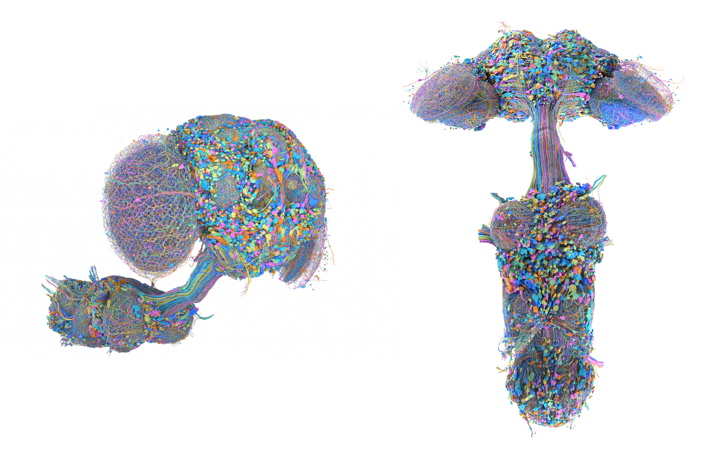
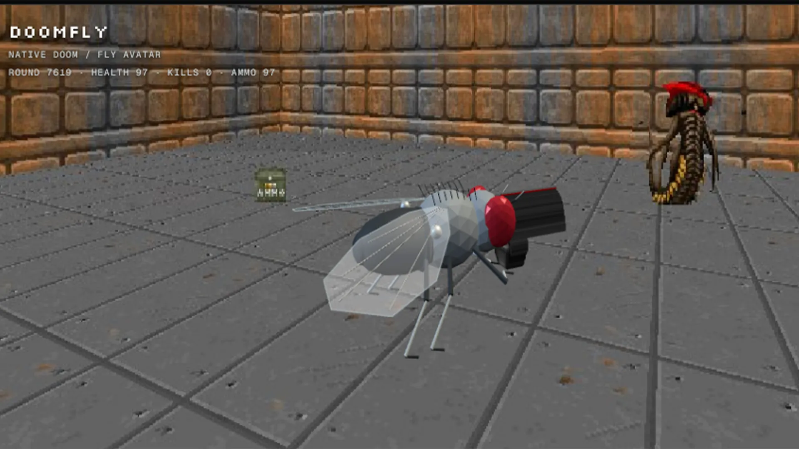

{"title":"“Can a fruit fly write a love letter?”","date":"2026-09-06","draft":false,"format":"html"}
---

<strong>&lt;When I say that something has learned, experienced, or expressed something, what evidence would actually allow me to say that?&gt;</strong>

<strong>2026. 09.03</strong> <a target="_blank" rel="noopener noreferrer" href="https://research.google/blog/a-connectomics-milestone-mapping-the-complete-male-fruit-fly-brain/">https://research.google/blog/a-connectomics-milestone-mapping-the-complete-male-fruit-fly-brain/</a> 구글에서 초파리의 뇌 신경망 지도를 공개했다. 처음 소식을 접했을 땐 커넥툼의 개념을 명확히 파악하지 못한 상태라, 초파리의 뇌가 디지털에서 복원된 것이라고 생각했다. 커넥툼은 지하철 시스템으로 비유하면 지하철 노선도 같은 개념이고, 노선도가 있다고 해서 우리가 교통 시스템을 이해할 수는 없는 것 처럼, 신경망의 모습을 복원한 것에 가까웠다.
<figure data-writing-image="true" style="width:50%"><figcaption>Figure1. Male Fly Connectum. 출처: <a href="https://research.google/blog/a-connectomics-milestone-mapping-the-complete-male-fruit-fly-brain/" target="_blank" rel="noopener noreferrer">Google Research</a></figcaption></figure>

<strong>2026. 09. 06</strong> 사람들은 이것을 가지고 재미있는 실험들을 하기 시작했다. Beatsaber, Doom, Minecraft를 Male fly CNS와 연결하여 시뮬레이션을 돌린다.
<ol><li>
<strong>Beatsaber</strong>
</li></ol><blockquote class="twitter-tweet">
the fly brain can play beat saber https://t.co/AqKMqD6gzP
— lyra (@_lyraaaa_) <a href="https://x.com/_lyraaaa_/status/2097527368919470162?ref_src=twsrc%5Etfw" rel="noopener noreferrer">September 9, 2026</a></blockquote><ol start="2"><li>
<strong>Doom</strong>
</li></ol><figure data-writing-image="true" style="width:50%"><figcaption>Figure 2. Fruit fly playing DOOM 출처: <a href="https://www.cnet.com/science/simulated-fruit-fly-brain-plays-doom/" target="_blank" rel="noopener noreferrer">CNET</a></figcaption></figure><ol start="3"><li>
<strong>Minecraft</strong> <a target="_blank" rel="noopener noreferrer" href="https://youtu.be/BUkLWjcoBc0?si=KlRoUrNpvu6Mw6vT">https://youtu.be/BUkLWjcoBc0?si=KlRoUrNpvu6Mw6vT</a>
</li></ol><iframe src="https://www.youtube.com/embed/BUkLWjcoBc0?si=KlRoUrNpvu6Mw6vT" title="YouTube video player" width="560" height="315" allowfullscreen="" loading="lazy" referrerpolicy="strict-origin-when-cross-origin"></iframe>
이에 더해 재미있는 행동들이 추가되기 시작했다. 초파리는 일종의 ai와 관련된 밈이 되어 세상을 떠돌기 시작했다.
<ol start="4"><li>
<strong>Bitcoin Trading</strong>
</li></ol><blockquote class="twitter-tweet">
I gave the fly brain $100 to trade bitcoin.

Dopamine neurons are stimulated when the fly makes profit. Neuron activity controls buy/sell decisions and makes trades on coinbase.

Will the fly get rich? <a href="https://t.co/XVWSFattGu" rel="noopener noreferrer">https://t.co/XVWSFattGu</a>
— Alex Wormuth (@wormuth) <a href="https://x.com/wormuth/status/2098012107652391357?ref_src=twsrc%5Etfw" rel="noopener noreferrer">September 10, 2026</a></blockquote><ol start="5"><li>
<strong>Dancing YMCA</strong>
</li></ol><blockquote class="twitter-tweet">
This fly can no longer experience love
I fine-tuned a MaleCNS model to hold Y-M-C-A poses in response to 4 specific tones. 

LoVP92, the section that held reproductive ambitions seems most affected. 

Open sourcing training code soon <a href="https://t.co/2uxvXkAJQq" rel="noopener noreferrer">https://t.co/2uxvXkAJQq</a>
— dhruv bhatia (@dhruvbhatia0) <a href="https://x.com/dhruvbhatia0/status/2097047404239581265?ref_src=twsrc%5Etfw" rel="noopener noreferrer">September 7, 2026</a></blockquote>
초파리에게 번아웃이 올 것 같이 느껴질 지경이었다. 이 현상을 바라보다 일종의 초파리 학대같이 느껴져 재미로 초파리 유언장을 만들었다.

<em>They Ruined Me</em>, 2026
<figure data-writing-image="true" style="width:50%"></figure>

