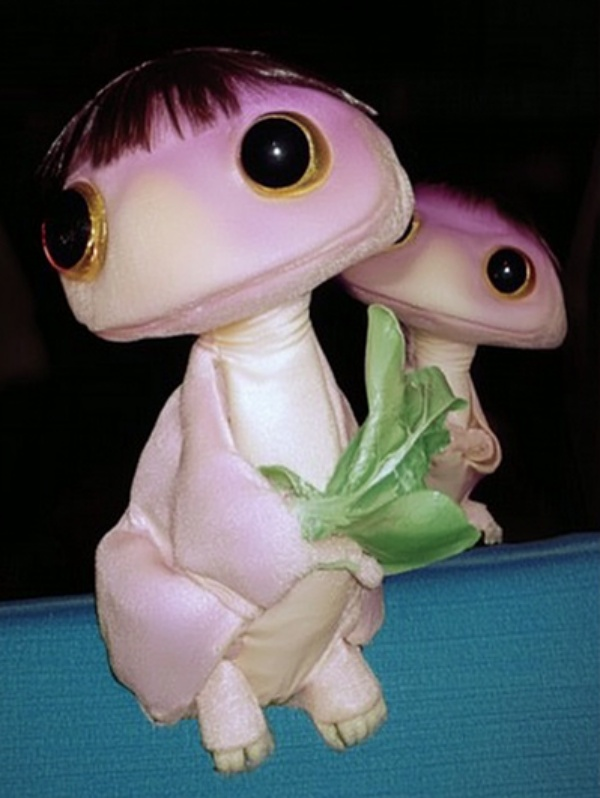
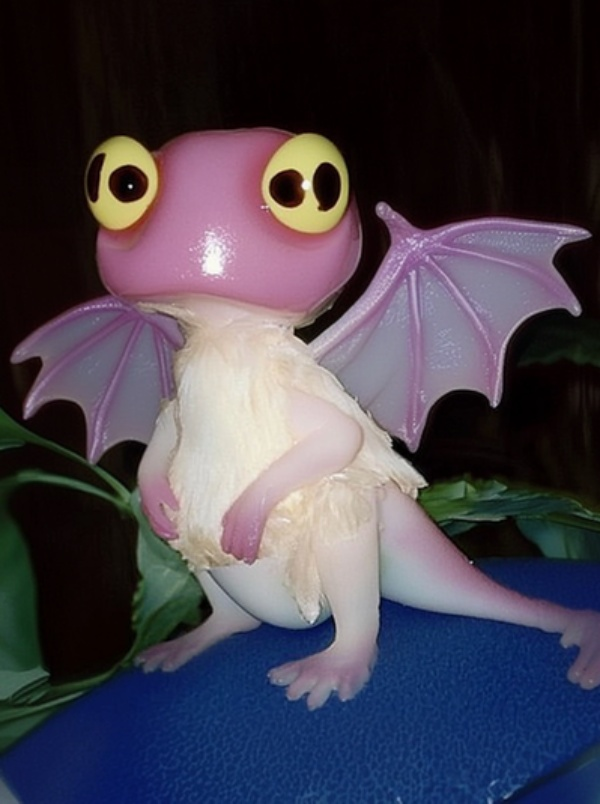
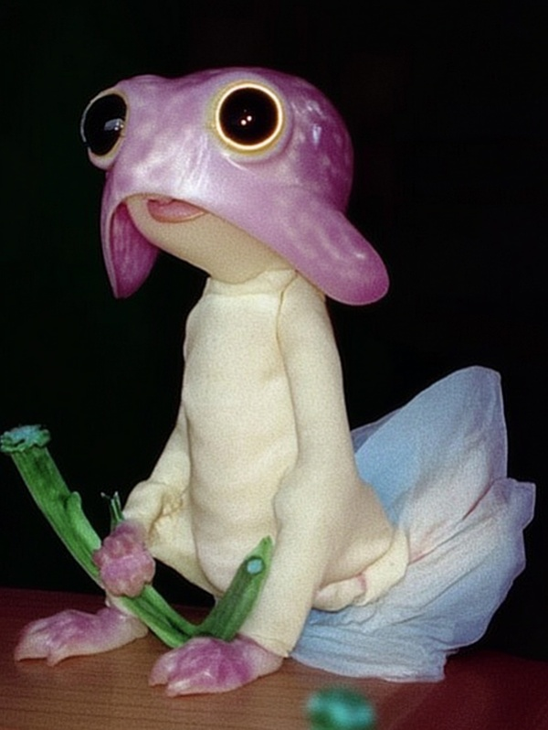
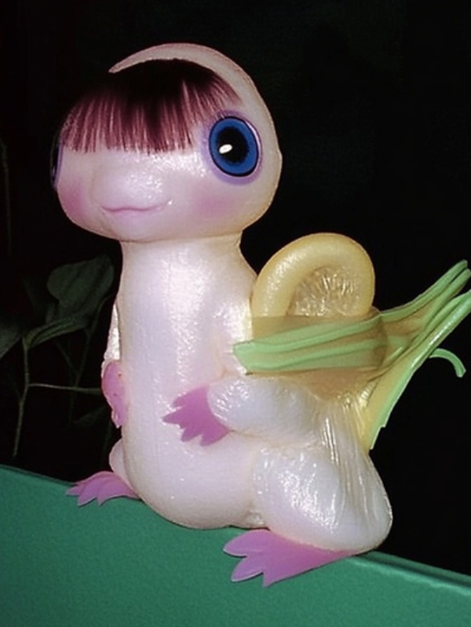
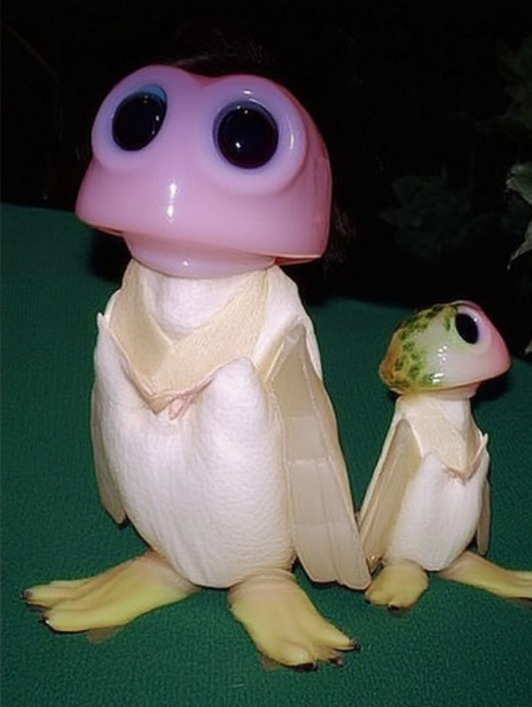
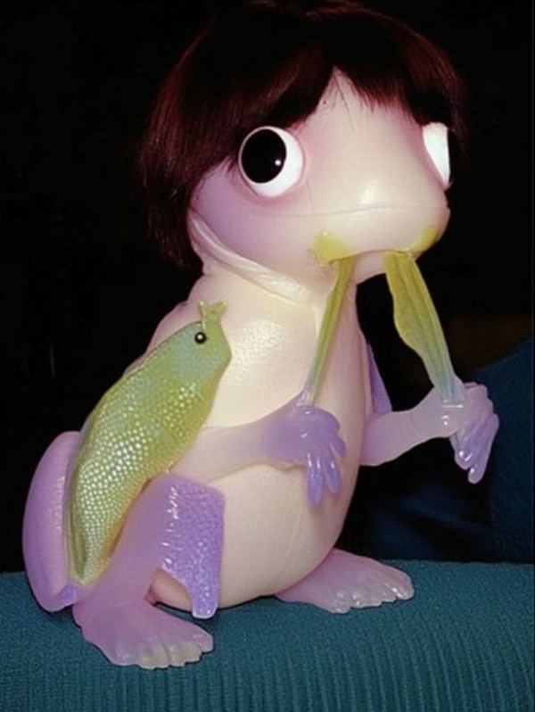
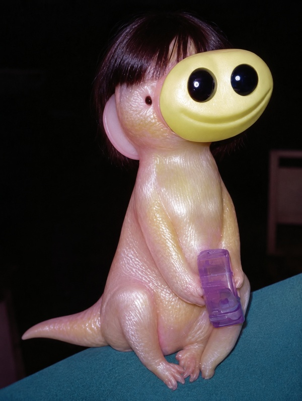
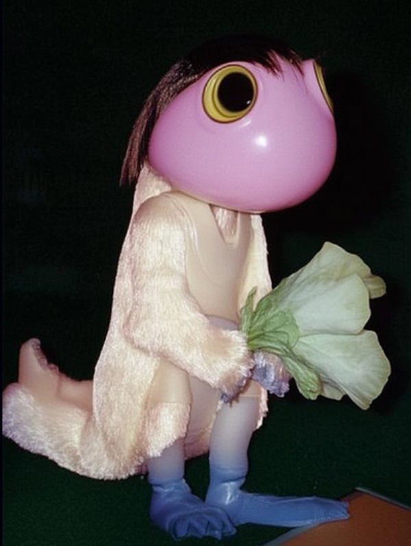
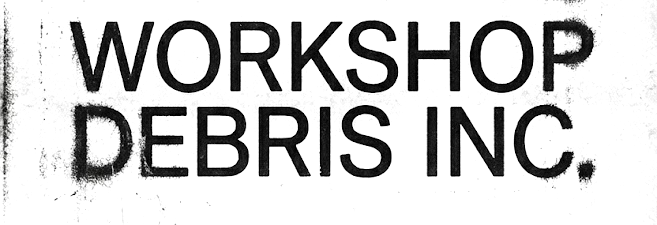

{"title":"The leftovers of cuteness : Where cute meets creepy","date":"2025-03-01","draft":false,"format":"html","canvas":true,"css":"","splitView":true,"firstGroupEnabled":true,"secondGroup":{"enabled":true,"body":"<h3>(ENG) The leftovers of cuteness : Where cute meets creepy</h3><h3>A collection of creatures that emerged unexpectedly while using AI to generate cute lizard characters. Drawn to their ambiguous forms and textures somewhere between toys and living organisms, and the way cuteness and creepiness coexist in them, I began collecting these failed images one by one.</h3>
<figure data-writing-image=\"true\" style=\"width: 100%;\"><figcaption>Demi &amp; Echo \"Do you… like it?”</figcaption></figure><figure data-writing-image=\"true\" style=\"width: 100%;\"><figcaption>Molu “I don’t know either”</figcaption></figure>

<figure data-writing-image=\"true\" style=\"width: 100%;\"><figcaption>Hetheti \"Expression shut down\"</figcaption></figure><figure data-writing-image=\"true\" style=\"width: 100%;\"><figcaption>Ashley williamshakespear “Born in London, Grew up in Tokyo”</figcaption></figure>

<figure data-writing-image=\"true\" style=\"width: 100%;\"><figcaption>Dobbie \"Can I.... help you?”</figcaption></figure><figure data-writing-image=\"true\" style=\"width: 100%;\"><figcaption>Halow the lonely (and Drobu the snail) “......\"</figcaption></figure>

<figure data-writing-image=\"true\" style=\"width: 100%;\"><figcaption>Proxy \"Let me smile for you”</figcaption></figure><figure data-writing-image=\"true\" style=\"width: 100%;\"><figcaption>Michelle May I \"....Shall we...\"</figcaption></figure>
<figure data-writing-image=\"true\" style=\"width: 20%;\"></figure>
All failed outcomes are proudly sponsored by WORKSHOP DEBRIS INC.
","css":"","format":"html","canvas":true}}
---
<h3>(KOR) The leftovers of cuteness : Where cute meets creepy</h3><h3>AI로 귀여운 도마뱀 캐릭터를 생성하는 과정에서 우연히 만들어진 생명체들. 장난감과 실제 생물 사이의 모호한 형태와 질감, 기괴함과 귀여움이 공존하는 모습이 마음에 들어, 실패한 이미지들을 하나씩 수집했다.</h3>
<figure data-writing-image="true" style="width: 100%;"><figcaption>Demi &amp; Echo "Do you… like it?”</figcaption></figure><figure data-writing-image="true" style="width: 100%;"><figcaption>Molu “I don’t know either”</figcaption></figure>

<figure data-writing-image="true" style="width: 100%;"><figcaption>Hetheti "Expression shut down"</figcaption></figure><figure data-writing-image="true" style="width: 100%;"><figcaption>Ashley williamshakespear “Born in London, Grew up in Tokyo”</figcaption></figure>

<figure data-writing-image="true" style="width: 100%;"><figcaption>Dobbie "Can I.... help you?”</figcaption></figure><figure data-writing-image="true" style="width: 100%;"><figcaption>Halow the lonely (and Drobu the snail) “......"</figcaption></figure>

<figure data-writing-image="true" style="width: 100%;"><figcaption>Proxy "Let me smile for you”</figcaption></figure><figure data-writing-image="true" style="width: 100%;"><figcaption>Michelle May I "....Shall we..."</figcaption></figure>
<figure data-writing-image="true" style="width: 20%;"></figure>
All failed outcomes are proudly sponsored by WORKSHOP DEBRIS INC.

